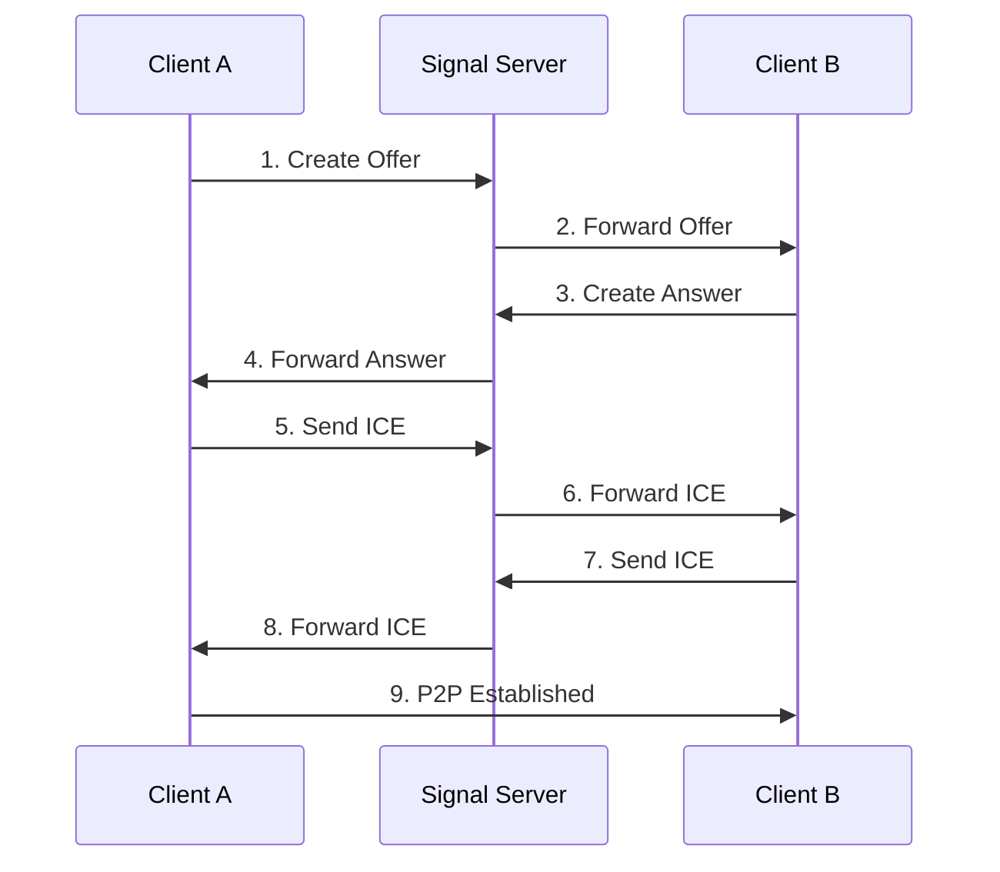
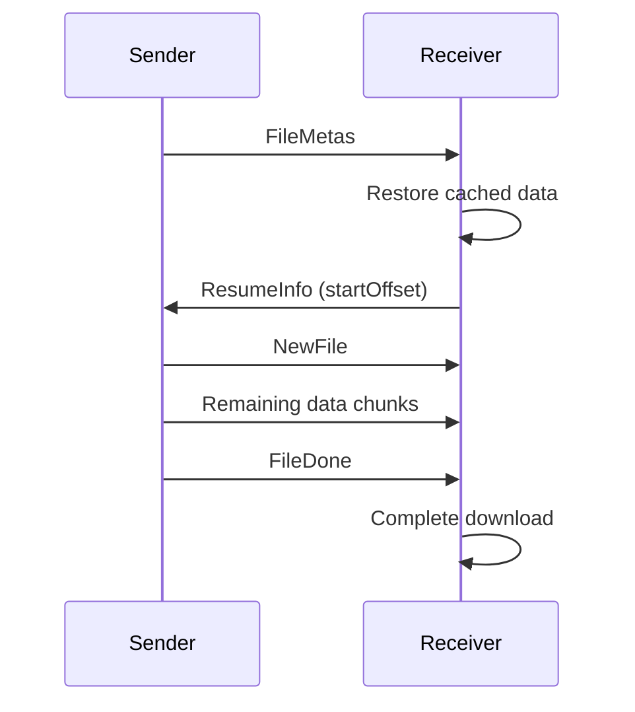

# 🔗 Web Share

<p align="center">
  <a href="./README.EN.md">English</a>
  <a href="./README.md">中文</a>
</p>

<p align="center">
  
  
  
  
  
  
  
</p>

<div style="display: flex; flex-wrap: wrap; gap: 1rem; justify-content: center; align-items: center;">
  
  
  
  
</div>

<br />

Browser-based file and text sharing over WebRTC. Files travel between devices; the server handles signaling and rooms.

> **Backend status**: `packages/server-go` is actively maintained. `packages/server` (TypeScript) is archived and no longer maintained. Use the Go backend for new deployments.

**Mobile note**: Opening the system file picker or switching apps may suspend the page and interrupt the connection. Return to the page and check the connection before continuing.

## ✨ Core Feature Highlights

- **File transfer**: Select, drag, or paste files; supports multiple files and image previews.
- **Connection options**: Join through a QR code, invitation link, or room code.
- **Streaming downloads**: Uses Service Worker or File System Access API when available, with an in-memory Blob fallback.
- **Resume transfers**: Caches received chunks locally and negotiates the resume offset when sending the file again.
- **Text sharing**: Send text between devices and copy received content.
- **Transfer progress**: Displays progress, speed, and estimated time remaining.
- **Interface**: Responsive layout, light/dark themes, and Chinese/English text.

---

## 📑 Table of Contents

- [Usage Guide](#-usage-guide)
  - [Go deployment](#go-single-binary-deployment)
  - [Go development](#local-development-go-backend)
  - [Server environment variables](#server-environment-variables)
- [FAQ](#-faq)
- [Architecture](#️-architecture)
- [Technical Deep Dive](#-technical-deep-dive)
  - [WebRTC Connection Mechanism](#webrtc-connection-mechanism)
  - [Resume Transfer Mechanism](#resume-transfer-mechanism)

---

## 🚀 Usage Guide

### Requirements

Prebuilt Go packages need no runtime dependencies. Building from source or developing locally requires:

- **Go**: >= 1.26.0
- **Node.js**: >= 22.0.0
- **pnpm**: >= 9.7.1
- **Modern browsers**: A modern browser with WebRTC support

### Installation

#### Clone Project

```bash
git clone https://github.com/beixiyo/web-share
cd web-share
```

#### Go Single-binary Deployment

Download a platform-specific Go deployment package with the frontend embedded in the executable from [GitHub Releases](https://github.com/beixiyo/web-share/releases). See the [release and deployment guide (Chinese)](./docs/releasing.md) for build automation and HTTPS configuration.

The target server needs no Docker, Node.js, or Go installation. See the [Go build and run guide (Chinese)](./packages/server-go/README.md#构建和运行) for source builds and cross-compilation.

#### Docker Deployment (Archived TypeScript Backend)

1. modify `docker-compose.yml` file's `VITE_SERVER_URL` environment variable to your WebSocket server address
2. (optional) to tune timeouts or invite policy, set server env vars in `docker-compose.yml`; see [Server environment variables](#server-environment-variables)
3. start docker containers
  ```bash
  docker compose down && docker compose up -d
  ```

#### Local Development (Go Backend)

```bash
# Install pnpm globally
npm i -g pnpm@9.7.1

# Install dependencies
pnpm i

# Start frontend, Go backend, and shared protocol watchers
pnpm run dev:go

# Start services individually
pnpm run dev:server:go     # Go signaling server
pnpm run dev:client        # Frontend client
pnpm run dev:common        # Build common types
```

#### Production Build

```bash
# Build the Go binary with the frontend embedded
pnpm run build:go

# Build individually
pnpm run build:common      # Build common package first
pnpm run build:server      # Archived TypeScript backend (reference only)
pnpm run build:client      # Client build
```

### Server environment variables

TS and Go use the same environment variable names and defaults. See the [shared configuration reference (Chinese)](./README.md#服务端环境变量) for ports, HTTPS certificates, heartbeat timeouts, reconnect grace periods, and invite settings. Go-specific configuration and validation are documented in the [Go backend guide (Chinese)](./packages/server-go/README.md#环境变量). Duration values are in milliseconds.

LAN discovery uses the server's IPv4 interface prefixes at startup, choosing the longest matching prefix. Set `LAN_CIDRS=192.168.4.0/23,10.0.0.0/24` to override discovery, especially with Docker bridge networking or a remote reverse proxy. Invalid or IPv6 CIDRs reject startup. Unmatched IPv4 addresses and IPv6 addresses remain isolated by full address; invitations and room codes still work across networks. Restart the backend after network or configuration changes.

Client addresses are read from `CF-Connecting-IP`, the first `X-Forwarded-For` entry, or the socket address, in that order, without extra configuration. Public IPv6 users are grouped by their complete address. Invalid or incomplete TLS configuration prevents startup rather than falling back to HTTP.

### Basic Usage

#### Create Connection

**Join by room code (others)**

1. Click **Link Code Management** in the toolbar
2. Switch to the **Enter code** tab and type the 6-digit code
3. Click **Join room** to enter the same room

**Join by QR or link**

- Host clicks **QR Code** on the invite card for others to scan, or **Link** to copy and share; opening the link in a browser joins the same room

#### File Transfer

1. Click the target device and select files, or paste/drag files and choose recipients.
2. The receiver reviews the file list and accepts or declines.
3. After acceptance, transfer starts and the receiver saves the file when complete.

#### Resume Transfer

**Auto-resume**:

- Saves progress automatically
- Prompts to continue after reconnect
- Supports cache cleanup

**Manual Management**:

- Click "Clear Cache" in toolbar
- Select cleanup policy (all/expired/failed)
- View cache usage

---

## ❓ FAQ

**Downloads fail or large files exhaust memory?**

Try a recent Chrome release and check available storage. Streaming downloads depend on browser support and a secure context. With the Blob fallback, the whole file stays in memory until it is saved, so file size is limited by available memory.

**Devices cannot connect?**

Check that both devices joined the same room, WebSocket signaling is reachable, and the browser supports WebRTC. NAT or firewall restrictions can still prevent a direct connection.

**Deployment loads the page but cannot connect?**

Check the WebSocket address, port mapping, and firewall. HTTPS pages must connect using WSS with a valid certificate. Go releases use same-origin signaling by default.

**Does the server receive my files?**

File contents are transferred over WebRTC DataChannel and are not stored by the signaling server. The server maintains room and connection state; receivers keep local chunks for resume. Anyone with the invitation or room code can join, so share them only with intended recipients.

---

## 🏗️ Architecture

```
┌─────────────────┐    WebSocket     ┌─────────────────┐
│   Client A      │◄────────────────►│   Signal Server │
│                 │                  │                 │
│  ┌─────────────┐│                  │  ┌─────────────┐│
│  │ Vue3 + TS   ││                  │  │ Go +        ││
│  │ WebRTC      ││                  │  │ WebSocket   ││
│  │ LocalForage ││                  │  │ Server      ││
│  └─────────────┘│                  │  └─────────────┘│
└─────────────────┘                  └─────────────────┘
         │                                    ▲
         │                                    │
         │          WebRTC P2P                │
         │         DataChannel                │
         ▼                                    │
┌─────────────────┐    WebSocket     ┌───────┴─────────┐
│   Client B      │◄─────────────────┤                 │
│                 │                  │                 │
│  ┌─────────────┐│                  │                 │
│  │ Vue3 + TS   ││                  │                 │
│  │ WebRTC      ││                  │                 │
│  │ LocalForage ││                  │                 │
│  └─────────────┘│                  │                 │
└─────────────────┘                  └─────────────────┘
```

---

## 🏗️ Architecture

### Structure

```
web-share/
├── packages/
│   ├── client/                        # Frontend
│   │   ├── src/
│   │   │   ├── ClientServer/          # WebRTC
│   │   │   ├── utils/                 # Utilities
│   │   │   ├── views/                 # Pages
│   │   │   └── components/            # Components
│   │   └── package.json
│   ├── server-go/                     # Go signaling server (maintained)
│   │   ├── cmd/web-share/             # Entry point
│   │   ├── internal/                  # Config, HTTP, and signaling
│   │   ├── protocol/                  # Shared protocol source
│   │   ├── web/                       # Embedded frontend assets
│   │   └── go.mod
│   ├── server/                        # TypeScript backend (archived, no maintenance)
│   │   ├── src/
│   │   │   ├── WSServer.ts            # WebSocket
│   │   │   └── main.ts                # Entry
│   │   └── package.json
│   └── common/                        # Shared
│       ├── src/
│       │   ├── generated/protocol.ts  # Generated protocol types and runtime values
│       │   ├── RTCData.ts             # WebRTC
│       │   └── index.ts               # Public exports
│       └── package.json
└── package.json                       # Root
```

### Core Modules

| Module | Responsibility |
|--------|----------------|
| `packages/client` | Browser UI, WebRTC connections, file transfer, and local resume cache. |
| `packages/server-go` | Maintained backend: signaling, rooms, invitations, heartbeat, and embedded frontend. |
| `packages/server` | Archived TypeScript backend; retained for reference. The existing Docker deployment uses this backend. |
| `packages/common` | Shared constants and generated TypeScript protocol definitions. See the [protocol generation guide (Chinese)](./packages/server-go/README.md#协议与-common-包). |

---

## 🔧 Technical Deep Dive

### WebRTC Connection Mechanism

The signaling server forwards SDP offers, answers, and ICE candidates. Once the DataChannel is open, browsers exchange file contents directly.



### Resume Transfer Mechanism

`ResumeManager` stores received chunks locally. Before transfer, `FileDownloadManager` restores cached data and sends the resume offset to `FileSendManager`.



Search for `@number.` comments in the client source to follow the transfer flow, or browse them with Todo Tree Enhanced.


---

<div align="center">

**If you find this useful, give it a ⭐!**

---

**Contact**

[](mailto:2662442385@qq.com)

</div>
