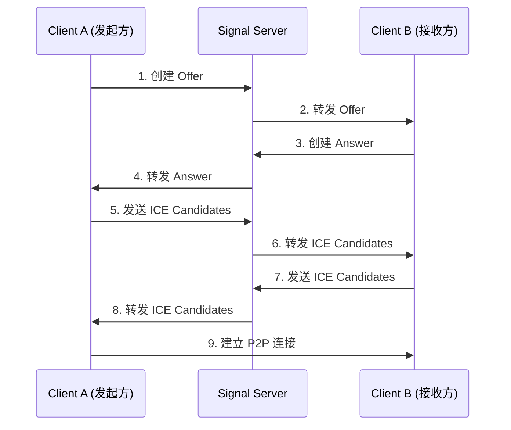
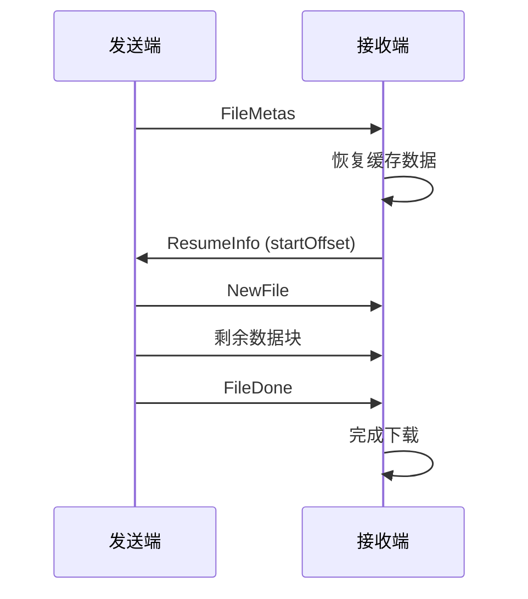

# 🔗 Web Share

<p align="center">
  <a href="./README.EN.md">English</a>
  <a href="./README.md">中文</a>
</p>

<p align="center">
  
  
  
  
  
  
  
</p>

<div style="display: flex; flex-wrap: wrap; gap: 1rem; justify-content: center; align-items: center;">
  
  
  
  
</div>

<br />

基于 WebRTC 的浏览器文件与文本共享工具。文件在设备间传输，服务端负责信令和房间管理

> **后端维护状态**：`packages/server-go` 为当前维护版本；`packages/server`（TypeScript）已归档，不再维护。新部署请使用 Go 后端

**移动端注意**：打开系统文件选择器或切换应用可能挂起页面并中断连接，返回页面后请确认连接状态

## ✨ 核心功能亮点

- **文件传输**：支持选择、拖拽或粘贴文件，可批量发送并预览图片
- **多种连接方式**：通过二维码、邀请链接或房间码加入同一房间
- **流式下载**：支持 Service Worker 和 File System Access API，不可用时回退到内存 Blob 下载
- **断点续传**：在本地缓存已接收的数据，再次发送文件时协商续传位置
- **文本共享**：跨设备发送文本，接收后可一键复制
- **传输进度**：显示进度、速度与预计剩余时间
- **界面适配**：支持响应式布局、明暗主题与中英文切换

---

## 📑 目录

- [使用说明](#-使用说明)
  - [Go 单二进制部署](#go-单二进制部署)
  - [Go 本地开发](#本地开发go-后端)
  - [服务端环境变量](#服务端环境变量)
- [常见问题](#-常见问题)
- [架构设计](#️-架构设计)
- [核心技术解析](#-核心技术解析)
  - [WebRTC 连接机制](#webrtc-连接机制)
  - [断点续传机制](#断点续传机制)

---

## 🚀 使用说明

### 环境要求

使用预编译 Go 部署包无需安装运行时依赖。源码构建和本地开发需要：

- **Go**: >= 1.26.0
- **Node.js**: >= 22.0.0
- **pnpm**: >= 9.7.1
- **浏览器**: 支持 WebRTC 的现代浏览器

### 安装和启动

#### 克隆项目

```bash
git clone https://github.com/beixiyo/web-share
cd web-share
```

#### Go 单二进制部署

可直接下载 [GitHub Release](https://github.com/beixiyo/web-share/releases) 中对应平台的 Go 部署包，前端已内嵌在可执行文件中。发布构建、附件内容和 HTTPS 配置见[发布与部署说明](./docs/releasing.md)

目标服务器无需安装 Docker、Node.js 或 Go。源码构建与交叉编译见 [Go 后端：构建和运行](./packages/server-go/README.md#构建和运行)

#### Docker 部署（已归档的 TS 后端）

1. 修改 `docker-compose.yml` 文件中的 `VITE_SERVER_URL` 环境变量为你的 WebSocket 服务器地址（HTTPS 时使用 `wss://你的域名:端口`）
2. （可选）如需 **HTTPS**：将证书放入 `certs/`（如 `key.pem`、`cert.pem`），在 `docker-compose.yml` 中取消 `volumes` 与 `SSL_KEY_PATH`、`SSL_CERT_PATH` 的注释，端口可按需改为 `"443:3001"`。证书也可通过环境变量 `SSL_KEY`、`SSL_CERT` 直接传入 PEM 内容
3. （可选）如需调整超时或邀请策略，可在 `docker-compose.yml` 中配置服务端环境变量，详见[服务端环境变量](#服务端环境变量)
4. 启动容器：
  ```bash
  docker compose down && docker compose up -d
  ```

#### 本地开发（Go 后端）

```bash
# 全局安装 pnpm
npm i -g pnpm@9.7.1

# 安装项目依赖
pnpm i

# 启动前端、Go 后端和共享协议监听
pnpm run dev:go

# 分别启动各个服务
pnpm run dev:server:go     # 启动 Go 信令服务器
pnpm run dev:client        # 启动前端客户端
pnpm run dev:common        # 构建公共类型包
```

#### 生产构建

```bash
# 构建内嵌前端的 Go 可执行文件
pnpm run build:go

# 分别构建
pnpm run build:common      # 先构建公共包
pnpm run build:server      # 构建已归档的 TS 后端（仅供参考）
pnpm run build:client      # 构建客户端
```

### 服务端环境变量

TS 与 Go 信令后端共用以下环境变量名称和默认值，其中时长单位均为**毫秒**。可用于兼容移动端切后台、选择文件时的挂起或短断连。Go 的 `HOST` 配置、参数校验与边界行为见 [Go 后端：环境变量](./packages/server-go/README.md#环境变量)

| 变量名 | 说明 | 默认值 |
|--------|------|--------|
| `PORT` | 服务监听端口。 | 3001 |
| `LAN_CIDRS` | 逗号分隔的 IPv4 网段，覆盖自动发现，例如 `192.168.4.0/23,10.0.0.0/24`。容器或反向代理后的服务可用它声明实际局域网；非法 CIDR 会拒绝启动。 | 未设置或空白时读取本机网卡网段 |
| `SSL_KEY_PATH` | HTTPS 私钥文件路径。与 `SSL_CERT_PATH` 同时设置时启用 HTTPS/WSS。 | - |
| `SSL_CERT_PATH` | HTTPS 证书文件路径。与 `SSL_KEY_PATH` 同时设置时启用 HTTPS/WSS。 | - |
| `SSL_KEY` | HTTPS 私钥 PEM 内容（与 `SSL_CERT` 同时设置时可替代文件路径）。 | - |
| `SSL_CERT` | HTTPS 证书 PEM 内容（与 `SSL_KEY` 同时设置时可替代文件路径）。 | - |
| `CLEAR_TIME` | 心跳超时与离线巡检间隔。仅用于判断 peer 是否失联；房主失联且房间清空时会触发 invite 清理。 | 300000 (5min) |
| `DISCONNECT_DELAY` | 会话恢复宽限期。WS 关闭后立即移出在线名单并广播离开，仅保留恢复身份；携带私有恢复令牌可在此期间恢复身份和房间。非正数表示立即清理恢复身份。 | 300000 (5min) |
| `ROOM_EMPTY_GRACE_MS` | 房间清空后邀请保留时间。空房超过此时长才删除 invite。 | 300000 (5min) |
| `ROOM_INVITE_TTL_MS` | 房间邀请有效期。-1 表示不限制。 | -1 |
| `DEFAULT_ROOM_CODE` | 默认房间码。设置后，任何人通过「输入连接码」输入该码即可进入同一固定房间，无需先有人建房或生成邀请；建议 6 位数字。不设置时使用内置默认码。 | 442385 |

客户端地址按 `CF-Connecting-IP`、`X-Forwarded-For` 首项、连接来源地址的顺序读取。启动时读取本机 IPv4 网段，匹配同一网段的客户端自动进入同一房间；重叠网段采用最长前缀。例如 `192.168.4.165` 和 `192.168.5.199` 在 `/23` 网段内可以互相发现。未匹配的 IPv4 与 IPv6 均按完整地址隔离，回环地址进入本地房间；跨网段仍可通过邀请或房间码加入。Docker 默认桥接网络无法自动获知宿主机局域网，请设置 `LAN_CIDRS`。配置只在启动时读取，网卡或配置变化后需重启后端

### 基本使用流程

#### 创建连接

**通过连接码加入（他人）**

1. 点击工具栏 **「连接码管理」**
2. 切换到 **「输入连接码」** 选项卡，输入对方提供的 6 位数字码
3. 点击 **「加入房间」** 即可进入同一房间

**通过二维码或链接加入**

- 对方在邀请卡片点击 **「二维码」** 后扫码，或点击 **「链接」** 复制后发送给你，在浏览器中打开即可加入同一房间

#### 文件传输

1. 点击目标设备并选择文件，或通过粘贴、拖拽文件后选择接收者
2. 接收方查看文件列表，选择接受或拒绝
3. 接受后开始传输，接收完成后保存文件


#### 断点续传

**自动断点续传**：

- 传输中断后，系统自动保存进度
- 重新连接后，提示是否继续传输
- 支持清理过期的传输缓存

**手动管理**：

- 在工具栏中点击"清理缓存"
- 选择清理策略（全部/过期/失败）
- 查看缓存占用空间

---

## ❓ 常见问题

**下载失败，或大文件导致内存不足？**

可先尝试新版 Chrome，并检查可用存储空间。流式下载依赖浏览器支持和安全上下文；回退到 Blob 时，文件会完整累积在内存中，大小受可用内存限制

**设备之间连接失败？**

确认双方加入同一房间、WebSocket 信令可达且浏览器支持 WebRTC。NAT 或防火墙限制仍可能阻止设备直连

**部署后页面能打开，但无法连接？**

检查 WebSocket 地址、端口映射和防火墙。HTTPS 页面需要使用 WSS 和有效证书；Go 发布包默认使用页面同源的信令地址

**服务器会接收我的文件吗？**

文件内容通过 WebRTC DataChannel 传输，信令服务器不存储文件，但会维护房间和连接状态；接收端会在本地缓存数据以供续传。持有邀请或房间码的人可以加入，请仅分享给预期的接收者

---

## 🏗️ 架构设计

### 项目结构

```
web-share/
├── packages/
│   ├── client/                        # 前端客户端
│   │   ├── src/
│   │   │   ├── ClientServer/          # WebRTC 连接管理
│   │   │   ├── utils/                 # 工具函数和文件处理
│   │   │   ├── views/                 # 页面组件
│   │   │   └── components/            # 通用组件
│   │   └── package.json
│   ├── server-go/                     # Go 信令服务器（维护中）
│   │   ├── cmd/web-share/             # 服务入口
│   │   ├── internal/                  # 配置、HTTP 与信令逻辑
│   │   ├── protocol/                  # 共享协议源定义
│   │   ├── web/                       # 内嵌前端资源
│   │   └── go.mod
│   ├── server/                        # TS 后端（已归档，不再维护）
│   │   ├── src/
│   │   │   ├── WSServer.ts            # WebSocket 服务器
│   │   │   └── main.ts                # 服务器入口
│   │   └── package.json
│   └── common/                        # 公共类型定义
│       ├── src/
│       │   ├── generated/protocol.ts  # Go 生成的协议类型与运行时值
│       │   ├── RTCData.ts             # WebRTC 数据类型
│       │   └── index.ts               # 公共导出入口
│       └── package.json
└── package.json                       # 根配置文件
```

### 核心模块

| 模块 | 职责 |
|------|------|
| `packages/client` | 浏览器界面、WebRTC 连接、文件传输与本地续传缓存。 |
| `packages/server-go` | 当前维护的后端：信令、房间、邀请、心跳与内嵌前端资源。 |
| `packages/server` | 已归档的 TS 后端，仅供参考；现有 Docker 部署使用此后端。 |
| `packages/common` | 共享常量与生成的 TypeScript 协议定义，见[协议生成说明](./packages/server-go/README.md#协议与-common-包)。 |

---

## 🔧 核心技术解析

### WebRTC 连接机制

信令服务器转发 SDP Offer、Answer 和 ICE 候选；DataChannel 建立后，浏览器直接传输文件内容



### 断点续传机制

`ResumeManager` 在本地保存已接收的数据块。传输前，`FileDownloadManager` 恢复缓存，并向 `FileSendManager` 告知续传偏移量



客户端源码使用 `@数字.` 注释标记传输流程，可直接搜索或使用 Todo Tree Enhanced 浏览


---

<div align="center">

**如果这个项目对你有帮助，请给个 ⭐ Star！**

---

**联系我**

[](mailto:2662442385@qq.com)

</div>
